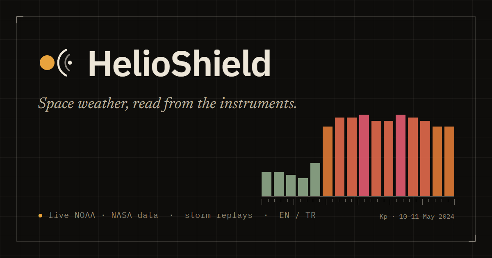
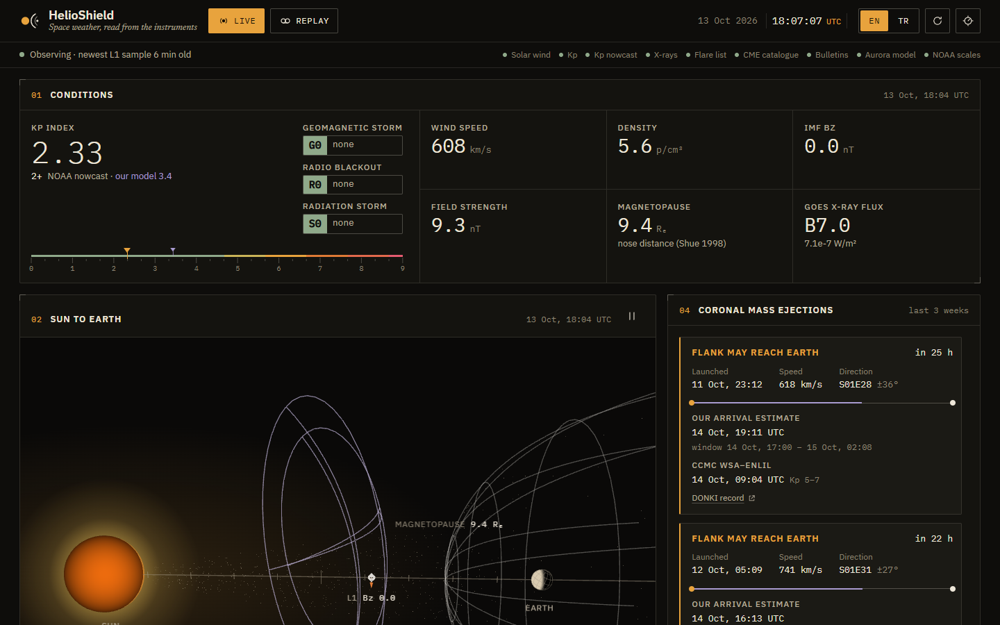
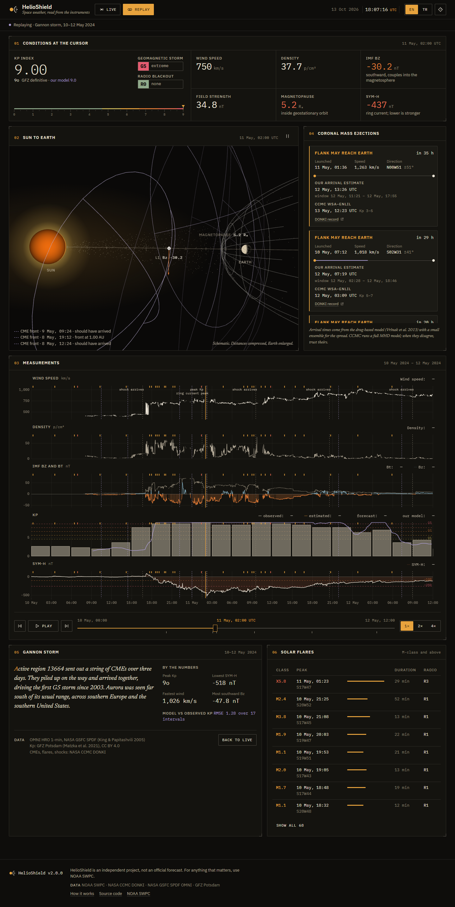
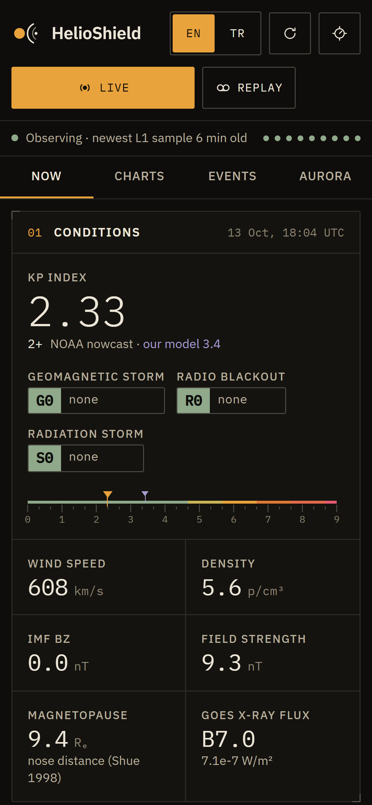
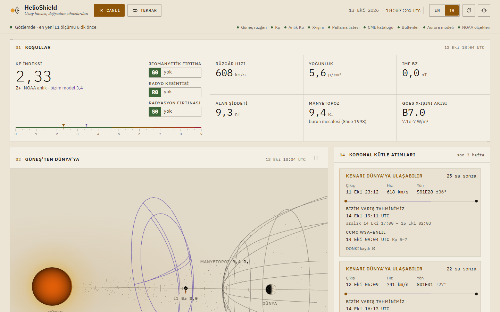

<p align="center">
  
</p>

# HelioShield

HelioShield is a space weather dashboard that reads the numbers straight from the instruments: the solar wind at L1, the Kp index, GOES X-rays, the CME catalogue, NOAA's bulletins and the OVATION aurora model. It also replays five historic geomagnetic storms from the original archives, so you can watch what Halloween 2003 or the May 2024 storm looked like minute by minute.

**Live:** [helioshield.vercel.app](https://helioshield.vercel.app) · English and Turkish · works offline once loaded



## Why I built it

Most space weather pages show you either raw plots with no context or a single traffic-light number with no way to check it. I wanted something in between. It should show what the spacecraft measure, add a few well-known models on top, and say clearly which numbers are measurements, which come from NOAA, and which are my own estimates.

HelioShield is not a forecast service. When it matters, use [NOAA SWPC](https://www.swpc.noaa.gov/).

## What's on the screen

| Panel | What it shows | Where it comes from |
|---|---|---|
| Conditions | Kp, G/R/S scales, wind speed, density, Bz, Bt, magnetopause distance | NOAA nowcast and scales; Shue 1998 for the magnetopause |
| Sun to Earth | 3D view of the wind, the magnetopause, IMF direction at L1, CME fronts in flight | Live readings, drag-based CME model |
| Measurements | 24 h of wind, field, Kp (observed, estimated, forecast and our model), X-rays | NOAA RTSW, Kp products, GOES |
| CMEs | Earth-bound CMEs with our arrival window next to CCMC's ENLIL run | NASA CCMC DONKI |
| Aurora | Chance of seeing it from your location, dark-sky window, polar map | NOAA OVATION Prime, NOAA Kp forecast |
| Bulletins | NOAA alerts, warnings and watches, with optional Kp notifications | NOAA SWPC |
| Flares, outlook | Last 7 days of flares with radio-blackout level; 3-day Kp and scale outlook | GOES flare list, NOAA forecast |

Replays swap every panel over to archived data (OMNI 1-minute solar wind, GFZ definitive Kp, SYM-H, DONKI CMEs and flares). You can play them, scrub them, and share a link to a moment:

```
https://helioshield.vercel.app/?event=gannon-2024&t=2024-05-11T02:00Z
```



<p align="center">
  
  &nbsp;&nbsp;
  
</p>

## How good are the models?

I tested both models against data they were not tuned on wherever I could. The full numbers are in [docs/validation.md](docs/validation.md).

- **Kp nowcast.** Fitted on 2000–2019 OMNI data and tested on 2020–2025: RMSE 0.69, 87% of 3-hour intervals within ±1. It saturates in the biggest storms and runs about one Kp high in them.
- **CME arrival (drag-based model).** Across seven well-observed CMEs the mean error is about 7 h. That is in line with published DBM results and close to CCMC's ENLIL on the same events. The parameters were picked on these same events, so treat it as a sanity check rather than an independent test.

## Running it

You need Node 20.19 or newer.

```bash
git clone https://github.com/SpaceEngineerSS/helioshield.git
cd helioshield
npm install
npm run dev
```

No API keys are needed. Every source is public, and DONKI moved to a keyless endpoint in September 2026.

| Script | What it does |
|---|---|
| `npm run dev` | Dev server. `/api/feed` runs the same edge code as production. |
| `npm run check` | Type check, lint, tests and production build. Run it before a PR. |
| `npm run smoke` | Builds, starts a preview, and drives it in Chrome: live data, language switch, replay, phone layout. |
| `npm run archive` | Re-downloads the replay archives from OMNI, GFZ and DONKI. |
| `npm run fit:kp` | Refits the Kp model coefficients and prints train/test error. |
| `npm run icons` | Redraws icons and the social card from the logo geometry. |
| `npm run screenshots` | Retakes the screenshots in this README from a running server. |

## Deploying

The repo deploys to Vercel as is. `api/feed.ts` becomes an edge function that fetches each upstream once per cache period for all visitors. That keeps the client download small: about 70 kB a minute of solar wind instead of 4 MB. Cache and security headers live in `vercel.json`. Nothing needs configuring.

On other hosts the static build still works. Without the edge function, the browser worker fetches NOAA and NASA directly and runs the same transforms itself.

## Documentation

- [Architecture](docs/architecture.md): how data gets from NOAA to the screen, and why it is shaped that way
- [Scientific model](docs/scientific-model.md): every formula, its source, and where it lives in the code
- [Data sources](docs/data-sources.md): endpoints, cadences, and what each one is used for
- [Validation](docs/validation.md): how the models compare to observations
- [Design](docs/design.md): the visual language and the rules behind it

## Credits

Data from NOAA's Space Weather Prediction Center, NASA's Community Coordinated Modeling Center (DONKI), NASA GSFC's Space Physics Data Facility (OMNI), and GFZ Potsdam (Kp, CC BY 4.0). The models are from published work, cited in [docs/scientific-model.md](docs/scientific-model.md).

Written by [Mehmet Gümüş](https://github.com/SpaceEngineerSS). MIT licensed; see [LICENSE](LICENSE). Contributions are welcome; [CONTRIBUTING.md](CONTRIBUTING.md) has the details.
