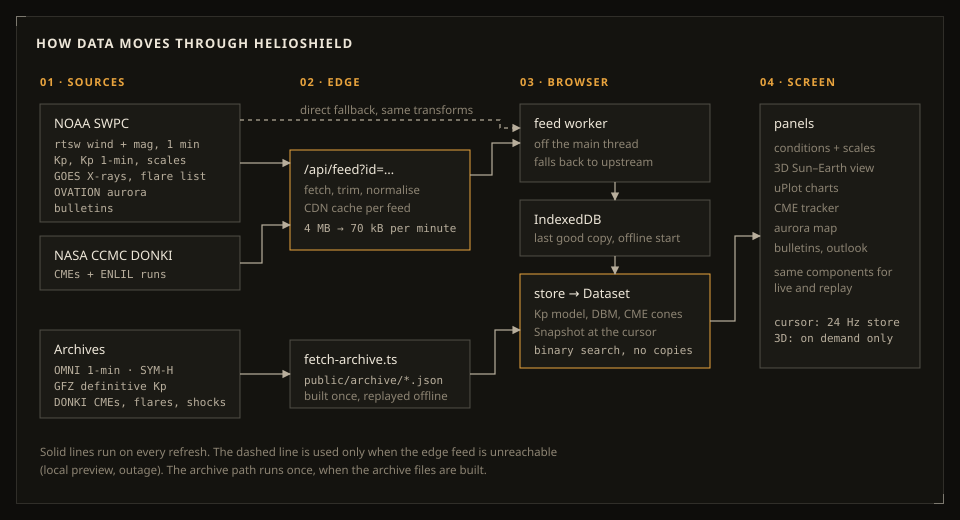

# Architecture



HelioShield is a static React app with one small edge function. There is no database and no server state. Everything you see is computed in the browser from public data.

## The four layers

**1. Sources.** Nine live feeds, all listed in `src/data/sources.ts` with their URL, cache period and credit line. Each has a parser in `src/data/transform.ts`. The parsers are deliberately forgiving: when SWPC renames a field or a row has `null`s, that row is skipped and the rest still works. Version 1 of this app broke quietly when two NOAA products were retired and the Kp product changed shape. v2 tests each parser against trimmed copies of real payloads (`src/test/fixtures`).

**2. Edge.** `api/feed.ts` takes `?id=solarwind` (or `kp`, `cme`, …), fetches the upstreams, runs the same transform, and returns compact JSON with `s-maxage`. Vercel's CDN then answers every visitor from one cached copy. The raw 1-minute solar wind products are about 4 MB together; the trimmed feed is about 70 kB before gzip. In development, Vite serves the same function through a small plugin in `vite.config.ts`, so the code path you test locally is the one in production.

**3. Browser.**
- `src/data/feed.worker.ts` does every fetch and parse in a Web Worker. It tries the edge feed first. If that fails (static hosting, edge outage) it fetches the upstream directly and runs the transform there, so a large JSON parse never blocks scrolling.
- `src/data/poller.ts` schedules each feed on its own cache period. It pauses while the tab is hidden, never overlaps two requests for the same feed, and backs off after failures.
- The last good copy of each feed goes into IndexedDB (`src/data/persist.ts`). A reload paints real data immediately, and the app opens offline.

**4. State and screen.** `src/state/store.ts` (zustand) holds the feeds, the preferences, and the playback cursor. `src/state/derive.ts` turns either the live feeds or a replay archive into one `Dataset`:
- solar wind
- Kp
- the model Kp series
- tracked CMEs with arrival estimates

It also reads a `Snapshot` of everything at the cursor. Panels only ever see these two objects, so live and replay share every component.

## Performance decisions

These are the choices that keep the app smooth on a cheap phone:

- **Small initial load.** Only about 135 kB of gzipped JavaScript loads up front. three.js (240 kB), uPlot and the map code are separate chunks. They load when their panel needs them, and the 3D chunk only when the scene scrolls into view.
- **Cursor updates are throttled to 24 Hz.** Playback writes the cursor to the store at most 24 times a second, not once per animation frame. Charts redraw only their overlay on cursor moves, and the panels read values by binary search.
- **The 3D scene renders on demand.** It only draws while something moves.
  - Wind particles are animated entirely in the vertex shader, so the CPU does nothing per frame.
  - The scene stops when it is off screen, when the tab is hidden, when motion is paused, or when the user prefers reduced motion.
  - Quality tiers (`src/features/scene/quality.ts`) start low on small or low-memory devices and step down automatically if frames drop.
  - Without WebGL, the scene falls back to a flat SVG drawing of the same layout.
- **Charts are uPlot on canvas,** with one shared cursor across all of them.

## Replays

`scripts/fetch-archive.ts` builds `public/archive/<event>.json` from three sources:
- OMNI HRO 1-minute data via CDAWeb HAPI
- GFZ definitive Kp
- DONKI CMEs, flares and interplanetary shocks

DONKI starts in 2010, so the 2003 event carries a short hand-entered list with references. Each file is about 250 kB raw and much smaller gzipped. The service worker caches a replay once it has been opened.

## Folder map

```
api/feed.ts              edge function
src/data/                sources, transforms, worker, poller, archive loader
src/model/               physics and scales, pure functions, no React
src/state/               store, derived dataset, playback, URL state
src/features/<panel>/    one folder per panel, component + CSS
src/ui/                  primitives: Panel, Readout, Ruler, Level, icons, Logo
src/i18n/                en.ts, tr.ts (typed: a missing key fails the build)
scripts/                 archive builder, Kp fit, figures, icons, screenshots, smoke test
```
