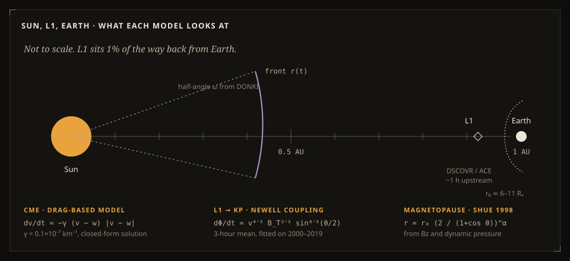

# Scientific model



Every model below is a published, well-known approximation. None of them is new. The point of HelioShield is to run them honestly on live data, show their uncertainty, and keep them apart from the official NOAA numbers. Each section gives the formula, the source, and the file it lives in.

## Kp nowcast from L1 solar wind

`src/model/coupling.ts`, `src/model/kp.ts`, fitted by `scripts/fit-kp.ts`

The energy entering the magnetosphere is tracked with the Newell et al. (2007) coupling function:

```
dΦ/dt = v^(4/3) · B_T^(2/3) · sin^(8/3)(θ/2)
B_T = √(By² + Bz²),   θ = atan2(|By|, Bz)   (GSM)
```

Kp is then estimated from 3-hour means of that term and of the viscous term √n·v², which Newell et al. (2008) found adds real skill:

```
Kp = a + b · (⟨dΦ/dt⟩ / 10⁴)^p + c · ⟨√n · v²⟩ / 10⁶
a = −0.5375, b = 2.438, c = 3.2186, p = 0.8
```

The coefficients come from ordinary least squares on OMNI2 hourly data from 2000–2019, with a grid search over p. They are tested on 2020–2025, which the fit never saw (see [validation](validation.md)).

For live data the measurement is at L1, about an hour upstream. The model value is shifted forward by the L1-to-Earth travel time at the measured speed, so the chart shows the time it applies to Earth. OMNI data used in replays is already shifted to the bow shock.

**Limitations.** The model reproduces the overall level well but saturates at Kp 9 in extreme storms. A single 3-hour average cannot capture the substorm structure that drives Kp spikes.

## Drag-based CME propagation

`src/model/dbm.ts`

The drag-based model of Vršnak et al. (2013, *Solar Physics* 285, 295) treats a CME as decelerating (or accelerating) toward the ambient wind speed w:

```
dv/dt = −γ (v − w) |v − w|
```

It has an exact solution, so HelioShield uses it directly instead of stepping an integrator:

```
v(t) = (v₀ − w) / (1 + γ|v₀ − w| t) + w
r(t) = sgn(v₀ − w)/γ · ln(1 + γ|v₀ − w| t) + w t + r₀
```

The launch is DONKI's `time21_5`, when the front passed 21.5 R☉, with r₀ = 21.5 R☉. Version 1 started the clock at first coronagraph appearance but placed the CME at 20 R☉, which made every arrival about six hours early. When a CME has no 21.5 R☉ time, the start time is paired with r₀ = 2.5 R☉.

The central run uses γ = 0.1×10⁻⁷ km⁻¹. The ambient wind w is the median measured wind in the six hours before launch, clamped to 300–700 km/s, or 450 km/s if there is no data. A nine-member ensemble varies γ over {0.05, 0.1, 0.2}×10⁻⁷ and w by ±75 km/s, and the screen shows the earliest-to-latest spread as the arrival window.

**Does it hit Earth?** `src/model/cme-geometry.ts`. DONKI gives the cone axis in Stonyhurst coordinates and a half-angle ω. Earth sits at longitude 0 and latitude B₀ (the solar B-angle, ±7.25° over the year). The great-circle angle between the axis and Earth decides the label:
- **direct:** within 0.6ω
- **flank:** within ω + 5°
- **miss:** otherwise

Version 1 called anything wider than 60° "Earth-directed", which is a test of size, not direction. When DONKI has no direction but CCMC's ENLIL run predicts an Earth arrival, the CME is tracked anyway.

**Limitations.** The model is 1D and radial, with constant γ and w. It ignores CME–CME interaction, which is exactly what happened in May 2024, and deflection.

## Magnetopause

`src/model/magnetopause.ts`

Shue et al. (1998, *JGR* 103, 17691):

```
r(θ) = r₀ · (2 / (1 + cos θ))^α
r₀ = (10.22 + 1.29 tanh(0.184 (Bz + 8.14))) · Dp^(−1/6.6)
α  = (0.58 − 0.007 Bz) · (1 + 0.024 ln Dp)
```

Dp = 1.6726×10⁻⁶ · n · v² nPa. The conditions panel shows the nose distance and warns when it falls inside geostationary orbit (6.6 Rₑ). In the 3D scene the solar wind particles are pushed onto this surface in the vertex shader, which is why the flow drapes around Earth.

## NOAA scales

`src/model/scales.ts`, `src/model/kp.ts`

- **G-scale from Kp.** SWPC counts the whole third-step band, so Kp 5- (4.67) is already G1 and 9- is G5.
- **R-scale from GOES 0.1–0.8 nm flux:**

  | Level | Flux (W/m²) | Class |
  |---|---|---|
  | R1 | ≥ 1×10⁻⁵ | M1 |
  | R2 | ≥ 5×10⁻⁵ | M5 |
  | R3 | ≥ 1×10⁻⁴ | X1 |
  | R4 | ≥ 1×10⁻³ | X10 |
  | R5 | ≥ 2×10⁻³ | X20 |

- **Live current scales** are NOAA's own (`products/noaa-scales.json`). They are not recomputed.

## Aurora

`src/model/aurora.ts`, `src/model/sun-position.ts`

- **Probabilities** come straight from NOAA's OVATION Prime grid (1° × 1°).
- **"On the horizon"** is the highest probability within 800 km on the poleward side. Aurora at about 110 km altitude stays above the horizon out to roughly that distance.
- **Geomagnetic latitude** uses a centred dipole with the pole at 80.8° N, 72.8° W (IGRF-14, 2025). Version 1 subtracted a flat 9.35°, which is only right near the American meridian.
- **The "view line" for tonight** is a rule of thumb read off the SWPC view-line charts: λ ≈ 66° − 2·Kp, using the highest NOAA forecast Kp during the dark hours. The panel says so.
- **Darkness** means the Sun is 12° or more below the horizon (nautical twilight). It uses the NOAA solar-position equations.

## What was removed in v2, and why

Version 1 shipped several modules that were never wired into the app. A few of them were also wrong:

- **GIC calculator.** Labelled Lehtinen–Pirjola but actually a half-space formula, and missing a 1/μ₀ factor.
- **Second Kp mapping.** Contradicted the first one.
- **Adaptive RK4 engine.** Started at Earth's radius and stopped at the Earth–L1 distance.
- **Random preset fallback.** When a feed failed, the app quietly showed synthetic data as if it were live.

All of these are gone. Missing data now shows as missing.

## References

- Newell, P. T., et al. (2007). A nearly universal solar wind–magnetosphere coupling function inferred from 10 magnetospheric state variables. *JGR*, 112, A01206.
- Newell, P. T., et al. (2008). Pairs of solar wind–magnetosphere coupling functions. *JGR*, 113, A04218.
- Vršnak, B., et al. (2013). Propagation of interplanetary coronal mass ejections: the drag-based model. *Solar Physics*, 285, 295–315.
- Shue, J.-H., et al. (1998). Magnetopause location under extreme solar wind conditions. *JGR*, 103(A8), 17691–17700.
- King, J. H., & Papitashvili, N. E. (2005). Solar wind spatial scales in and comparisons of hourly Wind and ACE plasma and magnetic field data. *JGR*, 110, A02104.
- Matzka, J., et al. (2021). The geomagnetic Kp index and derived indices of geomagnetic activity. *Space Weather*, 19, e2020SW002641.
- Newell, P. T., et al. (2010). Predictive ability of four auroral precipitation models as evaluated using Polar UVI global images. *Space Weather*, 8, S12004. (OVATION Prime)
