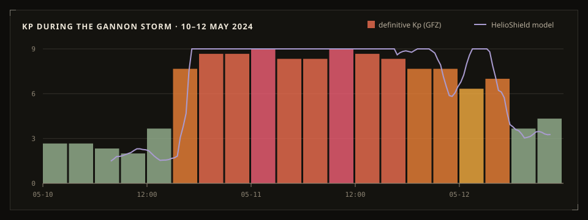
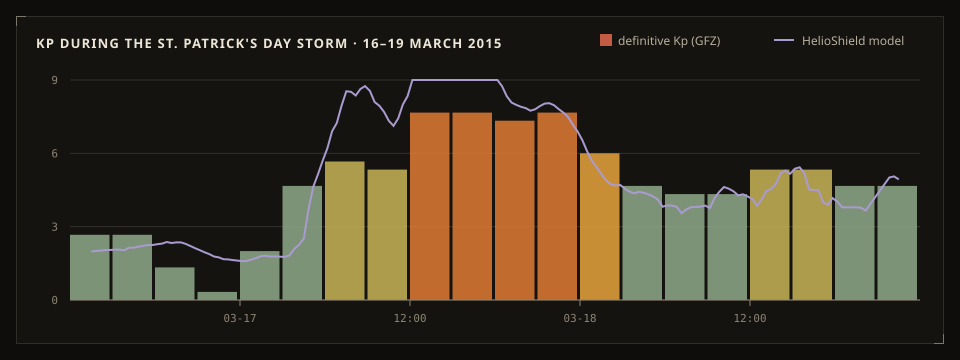
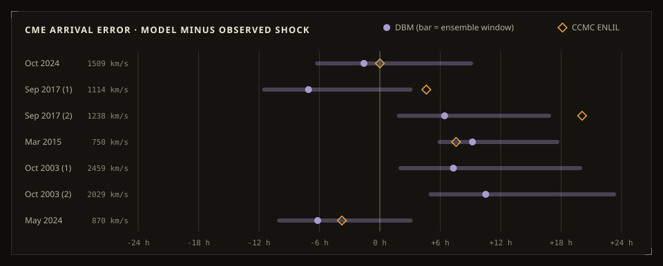

# Validation

Each model is compared against real observations, using data the model was not tuned on wherever possible. When a number is in-sample, it says so. Everything here can be regenerated:

```bash
npm run fit:kp                 # Kp fit, train/test metrics
npx tsx scripts/figures.ts     # the figures on this page
npm test                       # includes the DBM and Kp checks below
```

## Kp nowcast

The fit uses OMNI2 hourly data from 2000 to 2019 and is tested on 2020 to 2025.

| | Intervals | RMSE | MAE | r | within ±1 Kp |
|---|---|---|---|---|---|
| Train 2000–2019 | 57,019 | 0.69 | 0.54 | 0.86 | 87% |
| **Test 2020–2025** | 17,279 | **0.69** | **0.54** | **0.85** | **87%** |

The test score matches the training score, so the model is not overfitted. For comparison, version 1 mapped v = 400 km/s and Bz = −5 nT to Kp ≈ 6.7, a G2 storm. The refitted model gives about 2.8, which is what those conditions usually produce.

### In big storms

| Event | Intervals | RMSE | within ±1 | Peak observed | Peak model |
|---|---|---|---|---|---|
| Gannon, May 2024 | 17 | 1.28 | 65% | 9o | 9 |
| October 2024 | 20 | 0.89 | 70% | 8+ | 9 |
| September 2017 | 23 | 1.05 | 61% | 8+ | 9 |
| St. Patrick's Day 2015 | 20 | 1.19 | 65% | 8- | 9 |
| Halloween 2003 | 10 | 1.06 | 80% | 9- | 9 |

The model follows storm onset and recovery, but it saturates. During the main phase it usually reads about one Kp too high. Each replay shows the same comparison live, in the "By the numbers" box.





## CME arrival times

Each row compares the predicted arrival with the interplanetary shock observed at Earth: DONKI's `IPS` list, or the storm sudden commencement for 2003. The model runs from DONKI's or CDAW's launch data with w = 450 km/s. The app itself uses the measured pre-launch wind when it has it.

| Event | CME | Speed | Shock observed | DBM error | DBM window | ENLIL error |
|---|---|---|---|---|---|---|
| Oct 2024 | 09 Oct 02:12 | 1509 km/s | 10 Oct 14:46 | −1.6 h | −6.2 … +9.1 h | 0.0 h |
| Sep 2017 (1) | 04 Sep 20:36 | 1114 km/s | 06 Sep 23:08 | −7.1 h | −11.5 … +3.0 h | +4.6 h |
| Sep 2017 (2) | 06 Sep 12:24 | 1238 km/s | 07 Sep 22:30 | +6.4 h | +1.9 … +16.8 h | +20.1 h |
| Mar 2015 | 15 Mar 02:00 | 750 km/s | 17 Mar 04:05 | +9.2 h | +5.9 … +17.6 h | +7.6 h |
| Oct 2003 (1) | 28 Oct 11:30 | 2459 km/s | 29 Oct 06:11 | +7.3 h | +2.1 … +19.9 h | — |
| Oct 2003 (2) | 29 Oct 20:54 | 2029 km/s | 30 Oct 16:19 | +10.5 h | +5.0 … +23.2 h | — |
| May 2024 | 08 May 05:36 | 870 km/s | 10 May 16:36 | −6.2 h | −10.0 … +3.1 h | −3.8 h |

**Mean absolute error:**
- DBM: 6.9 h over 7 CMEs.
- ENLIL: 7.2 h over the 5 CMEs where DONKI has a run.



Some caveats about this table:

- **The DBM parameters were chosen here.** γ = 0.1×10⁻⁷ km⁻¹ and w = 450 km/s gave the lowest error out of a small grid inside the range Vršnak et al. recommend, on these same seven CMEs. With seven samples that is a calibration, not a test. Published DBM studies on larger sets report mean errors of about 10–14 h, which is the honest expectation.
- **ENLIL is not a fair rival here.** Some DONKI ENLIL runs are made or updated after the CME is well observed, sometimes close to arrival.
- **The Gannon CMEs interacted.** The May 2024 CMEs piled into each other on the way. No 1D model handles that, so the match for that event is partly luck.

The test `src/state/derive.test.ts` keeps this table honest. It fails if the mean error goes above 10 h, or if any observed arrival falls more than 6 h outside its ensemble window.

## Magnetopause, scales, geometry

These are direct implementations of published formulas or official thresholds, so they are unit-tested rather than validated:
- Shue 1998 gives r₀ = 10.25 Rₑ at Bz = 0 and Dp = 2 nPa.
- R-scale boundaries.
- G-scale thresholds in thirds.
- Solar B₀ range.
- Cone classification.
- Sun elevation at noon and midnight.
- A dark-window search that correctly finds no darkness in Tromsø at midsummer.

See `src/model/model.test.ts`.

## Test suite

| File | What it covers |
|---|---|
| `src/model/model.test.ts` | Coupling, Kp model, DBM (closed form checked against numerical integration), cone geometry, magnetopause, scales, aurora, sun position |
| `src/data/transform.test.ts` | Every parser against trimmed real payloads, including NOAA's zone-less timestamps |
| `src/state/derive.test.ts` | Replay datasets, storm-time snapshot, model skill during Gannon, DBM against observed shocks |
| `src/features/conditions/Conditions.test.tsx` | Rendering in Turkish with archive data |
| `src/test/csp.test.ts` | The inline script hash in `vercel.json` matches `index.html` |
| `scripts/smoke.ts` | Production build in Chrome: live data, language, replay playback, 390 px layout, no page errors |
